# Azure Logging & KQL Threat Hunting

Hunting through Azure control plane logs and NSG flow logs with KQL in a hosted Azure cyber range lab. Every use case is mapped to MITRE ATT&CK and NIST CSF 2.0.


---

## TL;DR

I learned how Azure splits up its logs, got comfortable enough with KQL to find things on my own, and then hunted through four tables. AzureActivity shows changes people make to Azure resources and NTANetAnalytics shows network traffic going through the NSG firewall. On the endpoints, DeviceLogonEvents covers every login attempt and DeviceProcessEvents covers every program that runs. I also exported raw logs and had AI suggest new detections so I could see what it gets right and where it makes stuff up.

## Why I Did This

I work in GRC. Part of my job is reviewing policy that says logs will be collected and monitored. I'd read that line a ton of times without ever being the person doing the monitoring. I wanted to sit in the actual logs, figure out which table answers which question, and see what it takes to turn a policy requirement into a query that catches somebody.

---

## Contents

1. [Environment](#environment)
2. [How the Logs Flow](#how-the-logs-flow)
3. [Part 1: Azure Logging Layers](#part-1-azure-logging-layers)
4. [Part 2: KQL Basics and Troubleshooting](#part-2-kql-basics-and-troubleshooting)
5. [Part 3: AzureActivity Hunting](#part-3-azureactivity-hunting)
6. [Part 4: NSG Flow Log Hunting (NTANetAnalytics)](#part-4-nsg-flow-log-hunting-ntanetanalytics)
7. [Part 5: DeviceLogonEvents Hunting](#part-5-devicelogonevents-hunting)
8. [Part 6: DeviceProcessEvents Hunting](#part-6-deviceprocessevents-hunting)
9. [Part 7: AI Testing](#part-7-ai-testing)
10. [Takeaways](#takeaways)
11. [References](#references)

---

## Environment

- **Lab:** hosted Azure cyber range lab, shared with other users
- **Log storage:** Log Analytics workspace with Microsoft Sentinel
- **Where I queried:** Microsoft Defender portal (Advanced Hunting) and Log Analytics
- **Endpoint telemetry:** Microsoft Defender for Endpoint on the lab VMs
- **Query language:** KQL
- **AI:** Claude

> Starting queries were provided with the lab environment. The beaconing and exfiltration queries in Part 4 and the lateral movement query in Part 5 were AI-generated and came with the lab too, so they're labeled that way. My own AI testing is in [Part 7](#part-7-ai-testing). Every query is saved in [`/queries`](./queries).

---

## How the Logs Flow

I drew this from what I learned in Part 1.

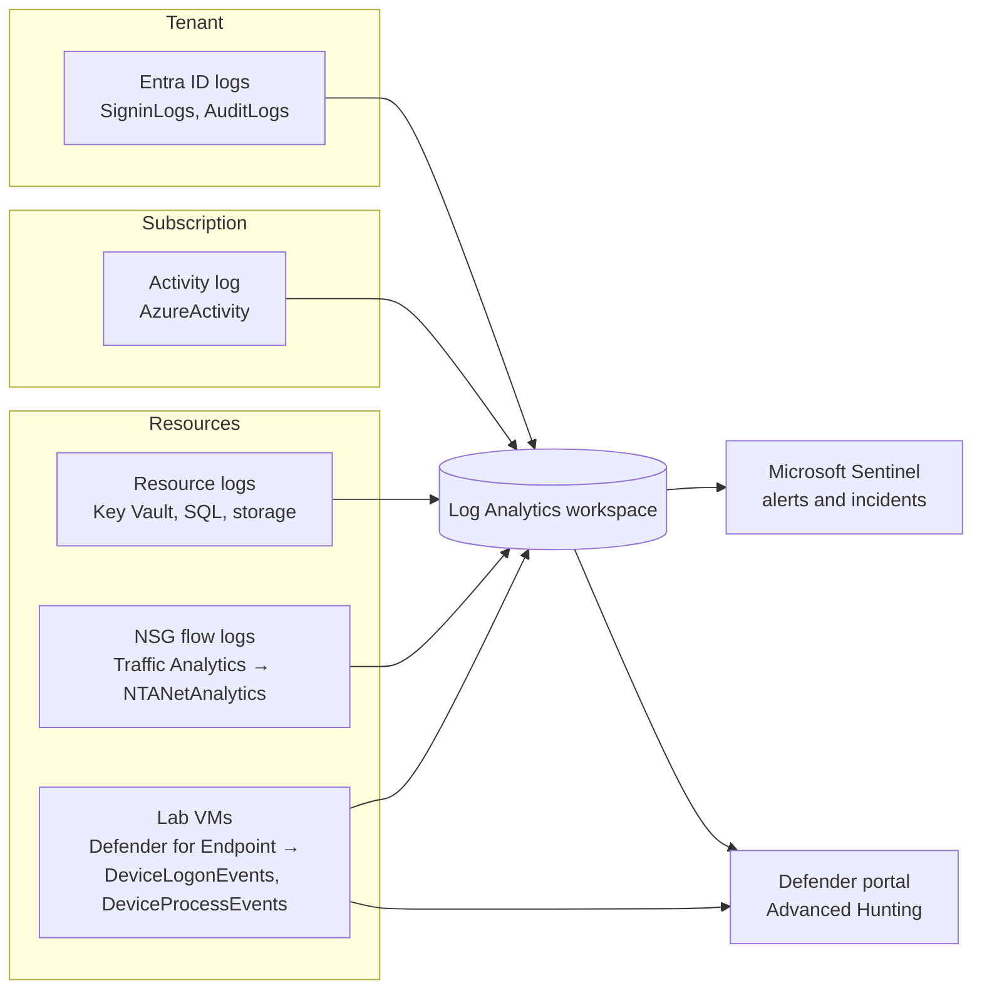

I ran the same `DeviceLogonEvents` query in the Defender portal and in Log Analytics and got the same rows back. That's how I confirmed both places were reading the same data.

---

## Part 1: Azure Logging Layers

### What I did

Went through the three places Azure logs come from and ran one query at each layer so I could see the difference in real data.

| Layer | Log | Table I queried | Question it answers |
|---|---|---|---|
| Tenant | Entra ID logs | `SigninLogs` | Who signed in, from where, and did it work |
| Subscription | Activity log | `AzureActivity` | Who changed what in Azure, and when |
| Resources | Resource logs / endpoint telemetry | `DeviceLogonEvents` | What happened inside the machine |

After that I ran the same `DeviceLogonEvents` query in the Defender portal and in Log Analytics to make sure the results matched.

> `DeviceLogonEvents` comes from Defender for Endpoint running on the VMs. It's endpoint telemetry, and I used it as the data plane example because it shows what happened inside the machine.

### Why I did it

Every investigation starts with picking the right table. Someone deleting a VM shows up in AzureActivity. Someone logging into that VM shows up in the VM's own logs. If I went looking for the login in AzureActivity I'd find nothing and probably assume nothing happened.

<details>
<summary><b>Queries</b></summary>

```kql
// Tenant layer: sign-ins for one user, with location pulled out of the JSON
SigninLogs
| where UserPrincipalName contains "<username>"
| project TimeGenerated, UserPrincipalName, UserDisplayName,
          City = LocationDetails.city,
          Country = LocationDetails.countryOrRegion

// Subscription layer: successful VM starts
AzureActivity
| where OperationNameValue == "MICROSOFT.COMPUTE/VIRTUALMACHINES/START/ACTION"
| where ActivityStatusValue == "Success"
| project TimeGenerated, OperationNameValue, Caller, CallerIpAddress, ActivityStatusValue

// Resource layer: failed logons on the VMs
DeviceLogonEvents
| where ActionType == "LogonFailed"
| project TimeGenerated, DeviceName, AccountName, RemoteIP, ActionType
```
</details>

<!-- SCREENSHOT 01: SigninLogs results with City and Country columns visible. Blur UserPrincipalName and UserDisplayName. -->
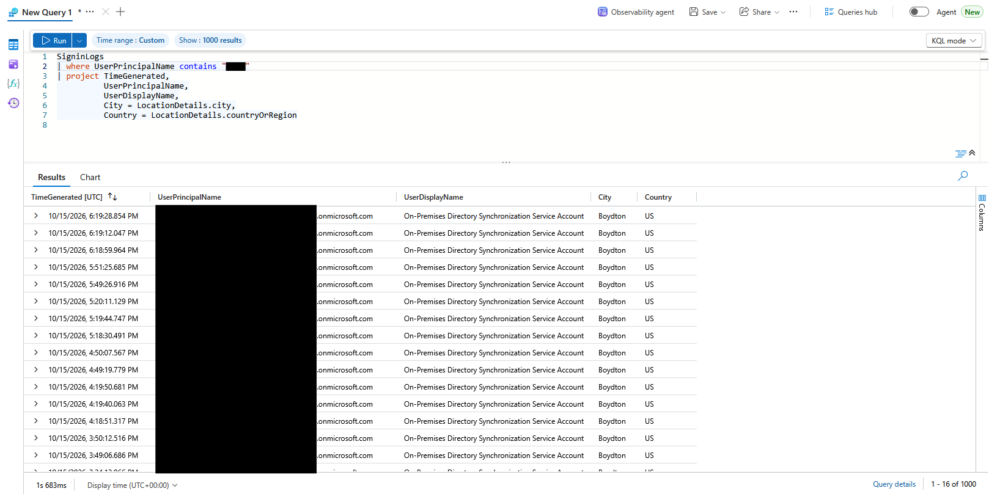
*Tenant layer. City and country pulled out of the `LocationDetails` JSON field.*

<!-- SCREENSHOT 02: AzureActivity VM start results showing OperationNameValue and CallerIpAddress. Blur Caller. -->
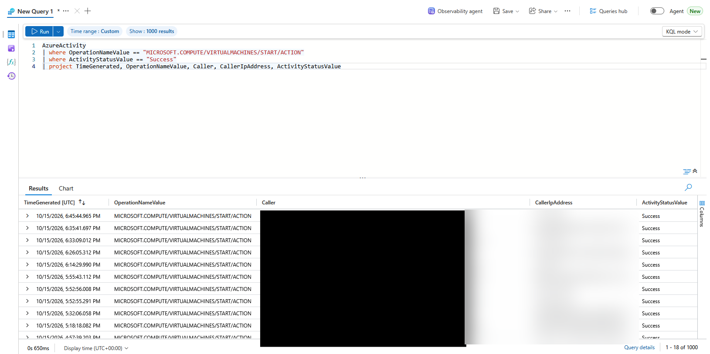
*Subscription layer. Successful VM start actions with the caller's IP.*

<!-- SCREENSHOT 03: DeviceLogonEvents LogonFailed results showing RemoteIP and ActionType. Blur DeviceName and AccountName. -->
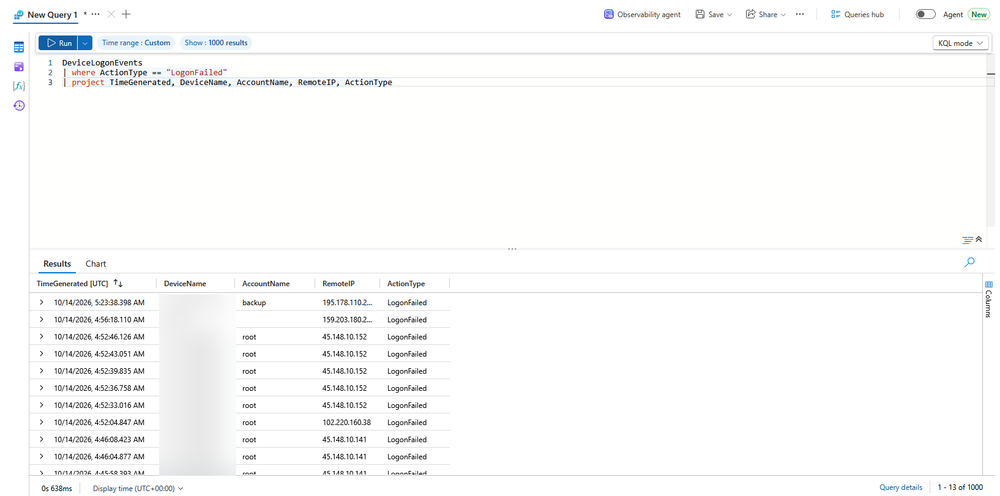
*Resource layer. Failed logons on the lab VMs.*

<!-- SCREENSHOT 04: Same DeviceLogonEvents query open in Defender and in Log Analytics, side by side or stacked, with matching rows. Blur device and account names. -->
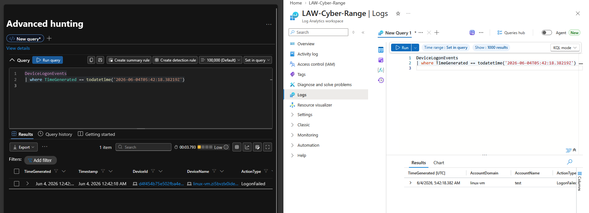
*Same query, same rows, two different portals.*

### What I took from it

The biggest thing was the split between management plane and data plane. Anything done to a resource from the Azure side, like creating a VM, editing an NSG rule, or assigning a role, gets logged in the Activity log. What happens inside the resource after that goes somewhere else. Logging into the VM, pulling a secret out of Key Vault, writing to a storage account, all of that is resource logs.

This one actually matters for my GRC work. The Activity log is collected automatically. Resource logs aren't collected until somebody creates a diagnostic setting for them. So a policy that just says "logging is enabled in Azure" could be technically true while nobody can see who's logging into the machines. When I review a logging control now, I want to know which plane it covers.

---

## Part 2: KQL Basics and Troubleshooting

### What I did

Learned the basic KQL pattern: pick a table, filter rows with `where`, pick columns with `project`. I used it on `DeviceLogonEvents` and `SigninLogs` and ran a failed-login hunt that stacks a few filters together. After that I worked a broken query that was supposed to find successful sign-ins from Osaka, Japan and kept coming back with zero results.

### Why I did it

Most of what I'll write in KQL is some mix of `where` and `project`. Knowing how to debug an empty result matters more to me than memorizing operators, because most of the time an empty result means I'm wrong about the data and the query itself is fine.

### The Osaka query

The query looked right to me. Last 30 days, successful sign-ins, city is Osaka, country is Japan. Zero rows.

I worked it broad to narrow. Pulled filters off until rows showed up, then added them back one at a time to see which one killed the results. It was the country filter. `LocationDetails.countryOrRegion` stores the two letter code `JP`, so `"Japan"` never matches anything. The fixed version also widens the window from 30 days to 365.

The habit I'm keeping from this is running `distinct` on a column before I filter on it. It shows exactly what values are in there.

<details>
<summary><b>Queries</b></summary>

```kql
// Failed-login hunt: stacking filters
SigninLogs
| where TimeGenerated > ago(7d)
| where isnotempty(ResultDescription)
| where IPAddress startswith "1"
| project TimeGenerated, ResultDescription, UserPrincipalName, IPAddress, Location

// BROKEN: returns 0 rows
SigninLogs
| where TimeGenerated > ago(30d)
| where ResultSignature == "SUCCESS"
| where LocationDetails.city == "Osaka"
| where LocationDetails.countryOrRegion == "Japan"
| project-reorder TimeGenerated, UserPrincipalName

// Check what values actually exist before filtering
SigninLogs
| distinct Location

// FIXED: country code instead of country name, wider window
SigninLogs
| where TimeGenerated > ago(365d)
| where ResultSignature == "SUCCESS"
| where LocationDetails.city == "Osaka"
| where LocationDetails.countryOrRegion == "JP"
| project-reorder TimeGenerated, UserPrincipalName
```
</details>

<!-- SCREENSHOT 05: The broken Osaka query with "No results" showing. -->
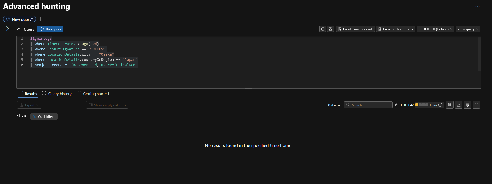
*The broken version. Logic looks fine, still zero rows.*

<!-- SCREENSHOT 06: distinct Location output showing two letter country codes like US, JP. -->
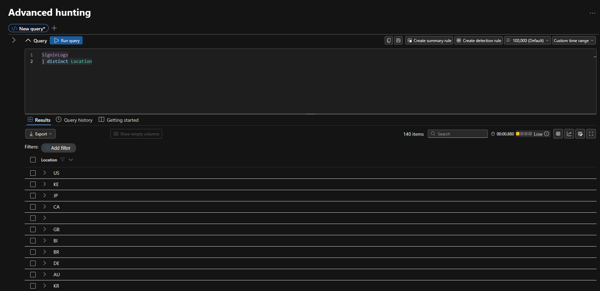
*`distinct` shows the column stores country codes.*

<!-- SCREENSHOT 07: The fixed Osaka query returning rows. Blur UserPrincipalName. -->
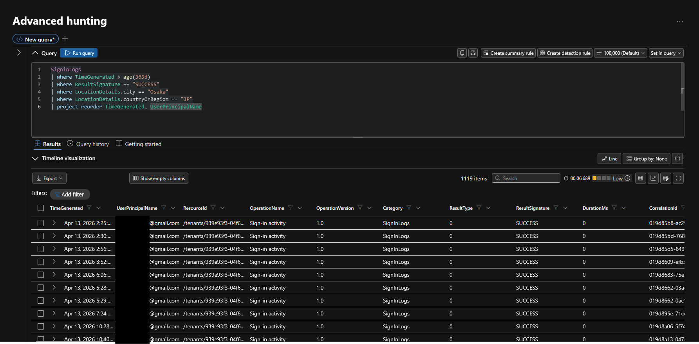
*Fixed version returning results.*

---

## Part 3: AzureActivity Hunting

**What this table is:** the Activity log for the subscription. Every write and delete operation on a resource, who did it (`Caller`), where they did it from (`CallerIpAddress`), and whether it worked (`ActivityStatusValue`).

**How I approached it:** read the [AzureActivity schema](https://learn.microsoft.com/en-us/azure/azure-monitor/reference/tables/azureactivity) first so I knew which columns exist, then ran each use case.

| # | Use case | MITRE ATT&CK | NIST CSF 2.0 |
|---|---|---|---|
| 1 | VM deletions | [T1578.003](https://attack.mitre.org/techniques/T1578/003/) Delete Cloud Instance | DE.CM-03 |
| 2 | VM creations | [T1578.002](https://attack.mitre.org/techniques/T1578/002/) Create Cloud Instance, [T1496](https://attack.mitre.org/techniques/T1496/) Resource Hijacking | DE.CM-03 |
| 3 | NSG rule changes | [T1562.007](https://attack.mitre.org/techniques/T1562/007/) Disable or Modify Cloud Firewall | DE.CM-03 |

> DE.CM-03: personnel activity and technology usage are monitored to find potentially adverse events.

### Use case 1: VM deletions

**What I did:** filtered the last 24 hours for successful `Microsoft.Compute/virtualMachines/delete` operations and pulled the caller, their IP, the resource group, and the resource ID.

**Why I did it:** deleting a VM can be sabotage, or it can be someone cleaning up a box they used so there's nothing left to look at. Keeping only `Success` shows deletes that actually went through. Failed deletes deserve their own look since that's someone trying something they don't have permission to do.

<details>
<summary><b>Query</b></summary>

```kql
AzureActivity
| where TimeGenerated > ago(24h)
| where OperationNameValue =~ "Microsoft.Compute/virtualMachines/delete"
| where ActivityStatusValue == "Success"
| project TimeGenerated, Caller, CallerIpAddress, OperationNameValue, ResourceGroup, _ResourceId
| sort by TimeGenerated desc
```
</details>

<!-- SCREENSHOT 08: VM deletion results showing TimeGenerated, CallerIpAddress, OperationNameValue, ResourceGroup. Blur Caller and anything in _ResourceId that names another user. -->
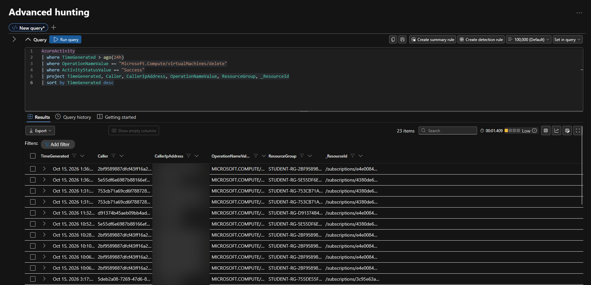
*Successful VM deletions in the last 24 hours.*

**What came back:** 23 deletions came back, with one caller deleting multiple VMs in a row within a short time frame.

### Use case 2: VM creations

**What I did:** same query shape, looking for successful `Microsoft.Compute/virtualMachines/write` operations.

**Why I did it:** someone with stolen Azure credentials can spin up their own VMs to mine crypto or keep a foothold in the environment. Something I noticed here: Azure uses one create-or-update operation for VMs, so `virtualMachines/write` fires when a VM is created and also when an existing VM gets changed. A hit could be either one, and you have to check the resource to know which.

<details>
<summary><b>Query</b></summary>

```kql
AzureActivity
| where TimeGenerated > ago(24h)
| where OperationNameValue =~ "Microsoft.Compute/virtualMachines/write"
| where ActivityStatusValue == "Success"
| project TimeGenerated, Caller, CallerIpAddress, OperationNameValue, ResourceGroup, _ResourceId
| sort by TimeGenerated desc
```
</details>

<!-- SCREENSHOT 09 (optional, skip if it looks the same as 08): VM creation results. Blur Caller. -->
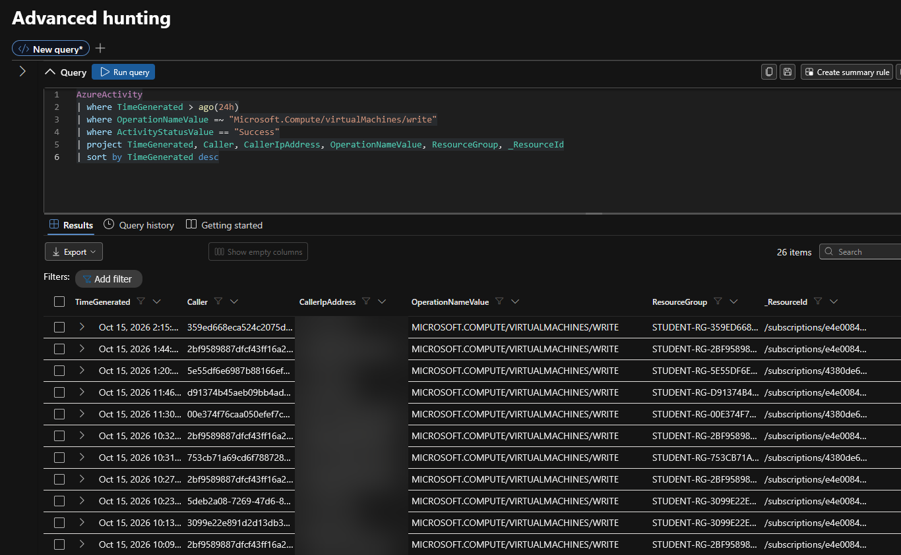
*Successful VM create or update operations.*

**What came back:** 26 successful VM creations came back in the last 24 hours.

### Use case 3: NSG rule changes

**What I did:** looked back 48 hours for any operation on `networkSecurityGroups` or `securityRules` ending in `write` or `delete`. This one doesn't filter on status, so it keeps successful and failed attempts.

**Why I did it:** opening a port or adding an allow-any rule is one of the first things you'd do to get in or get data out. I like that it keeps failed attempts, because someone trying to open the firewall without permission is worth knowing about even if it didn't work. Since there's no status filter, one change can also show up as more than one row as it moves through statuses, so `ActivityStatusValue` needs to be in the output.

<details>
<summary><b>Query</b></summary>

```kql
AzureActivity
| where TimeGenerated > ago(48h)
| where OperationNameValue has "networkSecurityGroups" or OperationNameValue has "securityRules"
| where OperationNameValue endswith "write" or OperationNameValue endswith "delete"
| project TimeGenerated, Caller, CallerIpAddress, OperationNameValue, ActivityStatusValue, ResourceGroup, _ResourceId
| sort by TimeGenerated desc
```
</details>

<!-- SCREENSHOT 10: NSG change results showing OperationNameValue and ActivityStatusValue. Blur Caller. If nothing came back, screenshot the empty result. -->
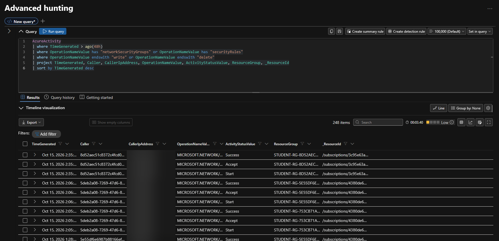
*NSG and security rule changes over 48 hours.*

**What came back:** 248 NSG rule changes came back over the last 48 hours, with a mix of different activity status values.

### What I made of AzureActivity

In a shared range, other users creating and deleting VMs is normal background activity, so the thing worth looking at is who did it. In a real environment I'd line these results up against approved change tickets and flag any change from someone who isn't supposed to be making it, or from an IP outside the org. That's basically a change management control turned into a query, and coming from GRC that's the part that clicked for me.

---

## Part 4: NSG Flow Log Hunting (NTANetAnalytics)

**What this table is:** NSG flow logs after Azure's Traffic Analytics processes them. Rows have the source IP, destination IP, port, protocol, which NSG rule matched (`AclRule`), and whether the traffic was allowed or denied. Traffic Analytics combines matching flows into one record per processing interval, which is 60 minutes by default or 10 minutes if you set it that way.

**How I approached it:** read the [NTANetAnalytics schema](https://learn.microsoft.com/en-us/azure/azure-monitor/reference/tables/ntanetanalytics), then set the investigation window once at the top with `let startTime` and `let endTime` so every query used the same range.

```kql
let startTime = datetime(2026-06-02 00:00:00);
let endTime = datetime(2026-06-03 00:00:00);
```

| # | Use case | Source | MITRE ATT&CK | NIST CSF 2.0 |
|---|---|---|---|---|
| 1 | Port scan (one source, 50+ ports) | Lab | [T1595](https://attack.mitre.org/techniques/T1595/) Active Scanning if the source is external, [T1046](https://attack.mitre.org/techniques/T1046/) Network Service Discovery if internal | DE.CM-01 |
| 2 | Traffic through overly permissive rules | Lab | N/A, this is an exposure check | PR.IR-01, DE.CM-01 |
| 3 | Denied inbound flows | Lab | [T1595](https://attack.mitre.org/techniques/T1595/) Active Scanning | DE.CM-01 |
| 4 | Beaconing | AI-generated | [T1071](https://attack.mitre.org/techniques/T1071/) Application Layer Protocol | DE.CM-01 |
| 5 | Data exfiltration (100 MB+ outbound) | AI-generated | [T1041](https://attack.mitre.org/techniques/T1041/) Exfiltration Over C2 Channel, [T1048](https://attack.mitre.org/techniques/T1048/) Exfiltration Over Alternative Protocol | DE.CM-01 |

> DE.CM-01: networks and network services are monitored to find potentially adverse events. PR.IR-01: networks and environments are protected from unauthorized logical access and usage.

### Use case 1: Port scan

**What I did:** Counted distinct destination ports for each source, destination, and NSG rule on allowed traffic, and flagged anything over 40.

**Why I did it:** One IP touching dozens of ports on the same box is recon. This query only looks at allowed traffic, so it shows scans that actually reached something. Scans the NSG blocked show up in use case 3.

<details>
<summary><b>Query</b></summary>

```kql
NTANetAnalytics
| where TimeGenerated between (startTime .. endTime)
| where FlowStatus == "Allowed"
| where isnotempty(SrcIp)
| summarize DistinctPorts = dcount(DestPort), Ports = make_set(DestPort, 50) by SrcIp, DestIp, AclRule
| where DistinctPorts > 50
| sort by DistinctPorts desc
```
</details>

<!-- SCREENSHOT 11: Port scan results showing SrcIp, DistinctPorts, AclRule. Attacker public IPs are fine to leave. Blur internal IPs if they tie to another user's VM name. If empty, screenshot the empty result. -->
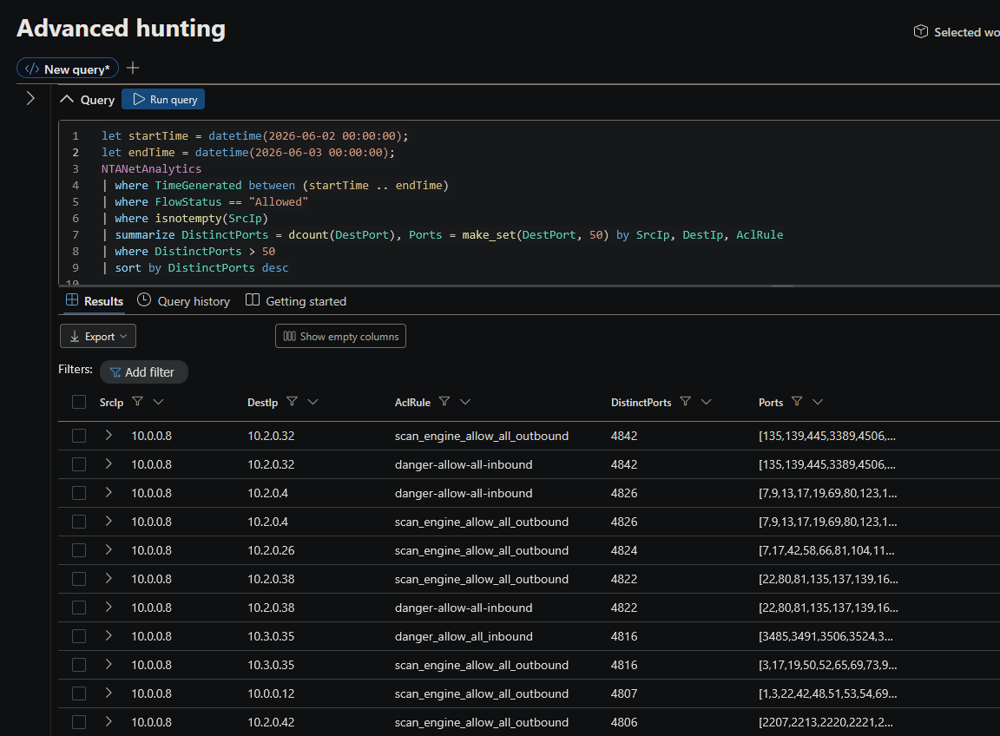
*Sources hitting more than 50 distinct ports.*

**What came back:** 41 results. 33 of them came from one internal IP, 10.0.0.8, hitting 17 different hosts and up to 4,842 distinct ports on a single machine. The rules it matched have names like `scan_engine_allow_all_outbound`, so it looks like the lab's vulnerability scanner doing its job, and a hit here doesn't automatically mean an attack. The other 8 results were hosts sending traffic back to 10.0.0.8 on 62 to 162 random high ports, which looks more like return traffic from the scan than a second scanner.

### Use case 2: Traffic through overly permissive rules

**What I did:** counted allowed flows, unique sources, and unique destinations for any NSG rule with `allow_all`, `danger`, or `any` in its name.

**Why I did it:** a wide-open rule with thousands of flows from hundreds of sources is a real exposure. This shows which risky rules are actually getting used, so you know what to fix first.

**My note on it:** this matches on the rule's name, so it only works if whoever made the rule named it honestly. A rule called `web-traffic` that allows every port from anywhere would slip right past. A better check would compare against the actual rule settings on the NSG.

<details>
<summary><b>Query</b></summary>

```kql
NTANetAnalytics
| where TimeGenerated between (startTime .. endTime)
| where FlowStatus == "Allowed"
| where AclRule has_any ("allow_all", "danger", "any")
| summarize FlowCount = count(), Sources = dcount(SrcIp), Dests = dcount(DestIp) by AclRule
| sort by FlowCount desc
```
</details>

<!-- SCREENSHOT 12: Permissive rule results showing AclRule, FlowCount, Sources, Dests. Do NOT include the Azure portal NSG page, it shows the subscription ID. -->
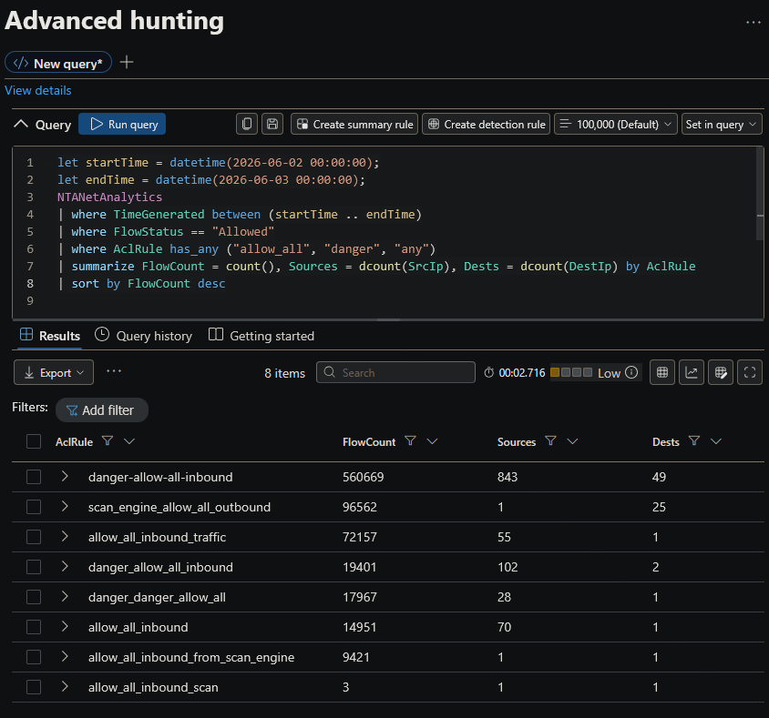
*Flow counts through risky-named NSG rules.*

**What came back:** **What came back:** 8 rules. `danger-allow-all-inbound` was by far the busiest, with about 560,000 allowed flows from 843 different source IPs to 49 destinations. That's roughly 70% of all the flows through these rules, and it's the one I'd lock down first. The two scan engine rules each had exactly 1 source, which lines up with the scanner from the port scan query. `allow_all_inbound_scan` barely got used, with only 3 flows.

### Use case 3: Denied inbound flows

**What I did:** summed denied inbound flows by source IP, destination, port, and protocol. In the summarize I renamed `SrcIp` to `IpAddress`.

**Why I did it:** these didn't get in, but it shows who's knocking and what they're going after. The rename was a small thing I liked. Once the column was called `IpAddress`, Defender recognized it as an IP and enriched it with extra context automatically. One column name change and I got more info for free.

<details>
<summary><b>Query</b></summary>

```kql
NTANetAnalytics
| where TimeGenerated between (startTime .. endTime)
| where isnotempty(SrcIp)
| where FlowDirection == "Inbound"
| where DeniedInFlows > 0
| summarize TotalDenied = sum(DeniedInFlows) by IpAddress = SrcIp, DestIp, DestPort, L4Protocol
| sort by TotalDenied desc
```
</details>

<!-- SCREENSHOT 13: Denied inbound results with the IpAddress column showing Defender's enrichment (hover card or icon). -->
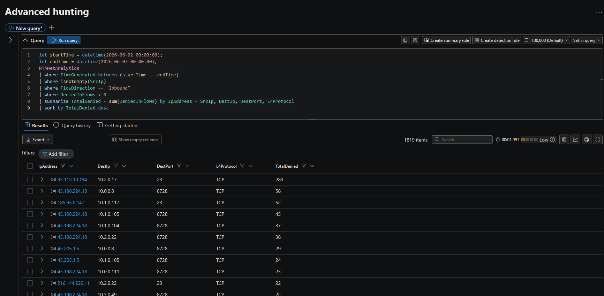
*Denied inbound flows. Renaming the column to `IpAddress` got Defender to enrich it.*

**What came back:** 1,819 denied inbound combinations. The top hit was 93.113.10.194 trying port 23 (Telnet) on one host 283 times. Most of the other top results were going after port 8728, which is the MikroTik router API. 45.198.224.18 tried it against at least 6 different internal hosts and 45.205.1.5 against 2. Telnet and router management ports are common targets for automated scanning bots, and the NSG blocked all of it. Renaming `SrcIp` to `IpAddress` worked too, since every IP in the results showed up as a clickable entity Defender could enrich.

### Use case 4: Beaconing (AI-generated)

**What I did:** ran an AI-generated query that lines up outbound flows for each source, destination, and port in time order, measures the gap between each one, and flags connections with at least 5 callbacks where the timing is really consistent. "Consistent" here means the standard deviation of the gaps divided by the average gap is under 0.2.

**Why I did it:** malware usually checks in with its command and control server on a set timer, so the time between connections ends up really even.

**Something I'd check before trusting a hit:** this table is already aggregated per processing interval. A normal connection that stays open all day could show up as one row every interval and look perfectly regular. So before calling something a beacon I'd compare the average gap to the processing interval. If the gap is 3600 seconds and the interval is 60 minutes, that's probably the aggregation talking.

<details>
<summary><b>Query</b></summary>

```kql
NTANetAnalytics
| where TimeGenerated between (startTime .. endTime)
| where FlowDirection == "Outbound"
| where isnotempty(SrcIp) and isnotempty(DestIp)
| order by SrcIp asc, DestIp asc, DestPort asc, TimeGenerated asc
| serialize
| extend Key = strcat(SrcIp, "_", DestIp, "_", DestPort)
| extend GapSeconds = iff(Key == prev(Key), datetime_diff('second', TimeGenerated, prev(TimeGenerated)), long(null))
| where isnotnull(GapSeconds)
| summarize Beacons = count(), AvgGap = avg(GapSeconds), StdevGap = stdev(GapSeconds) by SrcIp, DestIp, DestPort
| where Beacons >= 5
| extend Regularity = StdevGap / AvgGap   // lower = more robotic
| where Regularity < 0.2
| sort by Regularity asc
```
</details>

<!-- SCREENSHOT 14 (optional if empty): Beaconing results showing AvgGap and Regularity. -->
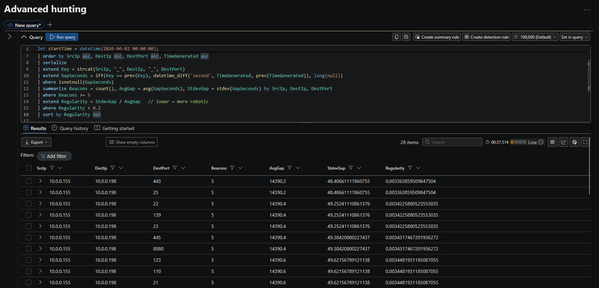
*Outbound connections with very regular timing.*

**What came back:** 28 results. The top ones were all the same pair, 10.0.0.155 talking to 10.0.0.198, on a bunch of different ports like 22, 23, 25, 110, 139, 443, 445, and 8080. Each one had 5 callbacks spaced about 14,390 seconds apart, which is almost exactly every 4 hours. The timing is robotic, but I don't read this as C2. Both IPs are internal, and malware usually calls out to one server on the internet over one port. One internal machine checking a whole list of service ports on another machine every 4 hours looks more like a scheduled scan or monitoring job. The gap is 4 hours, so it isn't just the Traffic Analytics processing interval showing up either.

### Use case 5: Data exfiltration (AI-generated)

**What I did:** summed bytes out and bytes in for allowed outbound flows headed to public IPs, converted to MB, and flagged anything over 100 MB. It also works out an out/in ratio.

**Why I did it:** large uploads to the internet are how data leaves. The ratio helps because normal use downloads a lot more than it uploads, so a machine sending way more than it receives stands out.

<details>
<summary><b>Query</b></summary>

```kql
NTANetAnalytics
| where TimeGenerated between (startTime .. endTime)
| where FlowDirection == "Outbound"
| where FlowStatus == "Allowed"
| where isnotempty(DestPublicIps)
| summarize TotalBytesOut = sum(BytesSrcToDest), TotalBytesIn = sum(BytesDestToSrc),
            FlowCount = count(), Ports = make_set(DestPort, 20)
            by SrcIp, DestIp, DestPublicIps
| extend TotalMBOut = round(TotalBytesOut / 1024.0 / 1024.0, 2)
| extend OutInRatio = todouble(TotalBytesOut) / (TotalBytesIn + 1)   // +1 avoids divide by zero
| where TotalMBOut > 100
| sort by TotalBytesOut desc
```
</details>

<!-- SCREENSHOT 15 (optional if empty): Exfil results showing TotalMBOut and OutInRatio. -->
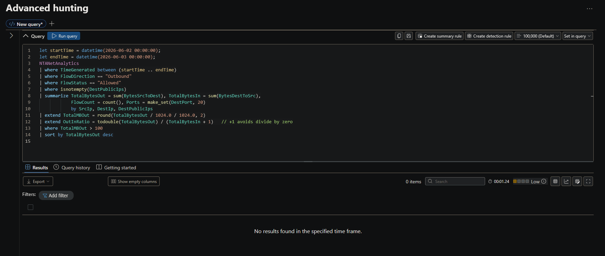
*Outbound transfers over 100 MB to public IPs.*

**What came back:** Zero results for the same June 2 to June 3 window the other NTANetAnalytics queries used, so the data was there. No machine sent more than 100 MB to a public IP in that day. An empty result is still a result here, and it's also why the 100 MB threshold matters. Someone sending smaller chunks over time would never trip it.

### Thresholds

I ran every threshold as provided: 50 ports, 5 callbacks, 0.2 regularity, 100 MB. Each of them has a blind spot. A slow scan that hits 40 ports over a whole day stays under 50. Malware that adds random jitter to its check-in timer can push regularity over 0.2. Someone pulling 90 MB a day for a week would never trip 100 MB in a single window. I'd want to see what normal looks like in a given environment before settling on numbers.

---

## Part 5: DeviceLogonEvents Hunting

**What this table is:** every logon attempt on the endpoints Defender for Endpoint is watching. Success or failure, which account, what kind of logon (`LogonType`), and where it came from (`RemoteIP`, `RemoteIPType`).

**How I approached it:** read the [DeviceLogonEvents schema](https://learn.microsoft.com/en-us/azure/azure-monitor/reference/tables/devicelogonevents), then set the investigation window once at the top like the NSG queries.

```kql
let startTime = datetime(2026-06-01 00:00:00);
let endTime = datetime(2026-06-02 00:00:00);
```

| # | Use case | Source | MITRE ATT&CK | NIST CSF 2.0 |
|---|---|---|---|---|
| 1 | Failed logons / brute force (10+ failures) | Lab | [T1110](https://attack.mitre.org/techniques/T1110/) Brute Force | DE.CM-03 |
| 2 | Successful logon after failures | Lab | [T1110](https://attack.mitre.org/techniques/T1110/) Brute Force, [T1078](https://attack.mitre.org/techniques/T1078/) Valid Accounts | DE.CM-03 |
| 3 | Remote logons from public IPs | Lab | [T1133](https://attack.mitre.org/techniques/T1133/) External Remote Services, [T1021.001](https://attack.mitre.org/techniques/T1021/001/) Remote Desktop Protocol | DE.CM-03 |
| 4 | Lateral movement (one account, 5+ devices in an hour) | AI-generated | [T1021](https://attack.mitre.org/techniques/T1021/) Remote Services, [T1078](https://attack.mitre.org/techniques/T1078/) Valid Accounts | DE.CM-03 |

### Use case 1: Failed logons / brute force

**What I did:** counted failed logons for each source IP, device, and failure reason, kept anything over 10 failures, and listed up to 20 of the account names that were tried.

**Why I did it:** brute force is loud, so one IP throwing a pile of failures at a machine stands out fast. The `Accounts` list tells you what kind of attack it is. The same account over and over is password guessing. A long list of different accounts from one IP looks more like password spraying.

**My note on it:** any machine with RDP or SSH open to the internet gets hit with failed logons constantly, so this one by itself is mostly background noise. Use case 2 is where it gets useful.

<details>
<summary><b>Query</b></summary>

```kql
DeviceLogonEvents
| where TimeGenerated between (startTime .. endTime)
| where ActionType == "LogonFailed"
| summarize FailedCount = count(), Accounts = make_set(AccountName, 20)
    by RemoteIP, DeviceName, FailureReason
| where FailedCount > 10
| sort by FailedCount desc
```
</details>

<!-- SCREENSHOT 16: Brute force results showing RemoteIP, FailedCount, FailureReason, Accounts. Attacker IPs are fine. Blur DeviceName and any real user account names in Accounts. -->
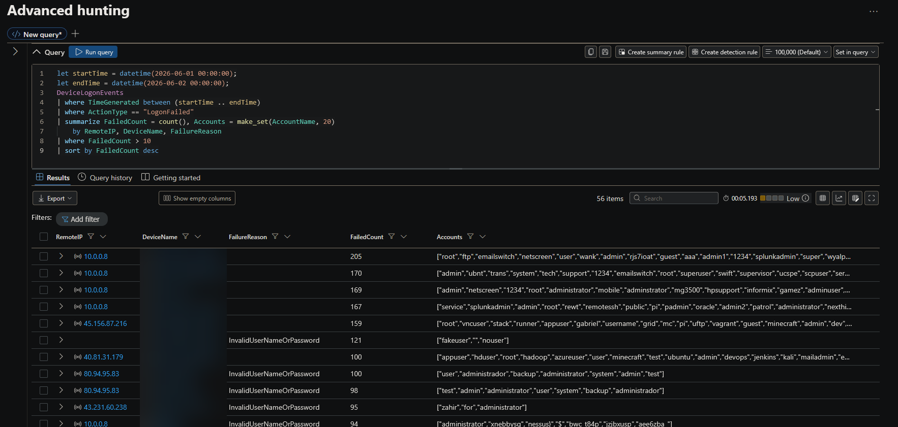
*Sources with more than 10 failed logons against one device.*

**What came back:** 56 results. The top four were all from 10.0.0.8, the same scanner from the port scan query, with 167 to 205 failed logons each against Linux VMs. It was trying default usernames like root, admin, ftp, and ubnt, which looks like the vulnerability scanner checking for default credentials. The real brute forcing came from outside IPs. 45.156.87.216 hit one Linux VM 159 times with a long list of usernames like root, vagrant, minecraft, and pi. 80.94.95.83 went after two different Windows VMs about 100 times each with the same short list of accounts, like administrator, administrador, backup, and user. The Windows failures all showed a FailureReason of InvalidUserNameOrPassword, while the Linux ones had no FailureReason at all.

### Use case 2: Successful logon after failures

**What I did:** built two lists, one counting failures and one counting successes (plus the last success time) for each account, device, and source IP. Then I joined them so only the combos that show up in both lists come through, and kept anything with more than 10 failures and at least one success. The lab flagged this one as complex, so before running it I had Claude explain it to me in plain English.

**Why I did it:** this is the brute force that worked. Failures plus a success from the same IP, on the same account, on the same machine means someone probably got in.

Here's how the query fits together:

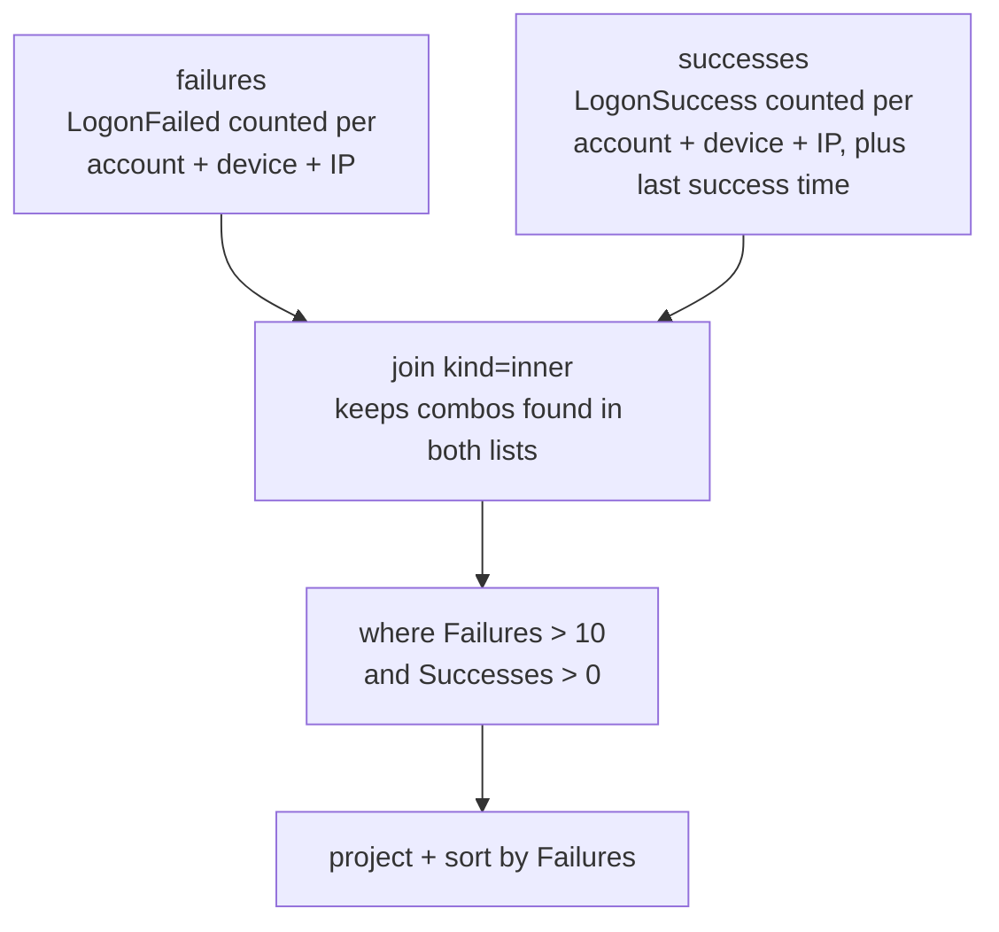

**My note on it:** the join doesn't check the order things happened in. If someone logged in successfully at 8 AM and then had 11 failures at 9 AM, it still matches. A real user fat-fingering their password 11 times and then getting it right would match too. To be sure it's failures followed by a success, I'd compare the time of the first failure to `LastSuccess`.

<details>
<summary><b>Query</b></summary>

```kql
let failures =
    DeviceLogonEvents
    | where TimeGenerated between (startTime .. endTime)
    | where ActionType == "LogonFailed"
    | summarize Failures = count() by AccountName, DeviceName, RemoteIP;
let successes =
    DeviceLogonEvents
    | where TimeGenerated between (startTime .. endTime)
    | where ActionType == "LogonSuccess"
    | summarize Successes = count(), LastSuccess = max(TimeGenerated)
        by AccountName, DeviceName, RemoteIP;
failures
| join kind=inner successes on AccountName, DeviceName, RemoteIP
| where Failures > 10 and Successes > 0
| project AccountName, DeviceName, RemoteIP, Failures, Successes, LastSuccess
| sort by Failures desc
```
</details>

<!-- SCREENSHOT 17: Success-after-failures results showing Failures, Successes, LastSuccess. Blur AccountName and DeviceName. If empty, screenshot the empty result. -->
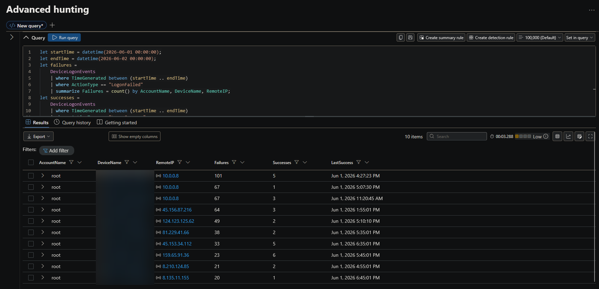
*Account, device, and IP combos with 10+ failures and at least one success.*

**What came back:** 10 results, all for the root account on Linux VMs. Three came from 10.0.0.8, the scanner again, which also had successful root logons on each machine. That makes sense if it runs credentialed scans. The other seven were outside IPs that racked up 20 to 64 failed logons and then logged in successfully as root. For example, 45.156.87.216 had 64 failures and 3 successes on one VM. In a real environment every one of those would be a compromise to investigate right away, and it means root can log in remotely with a password. Most of the outside successes landed at exactly :01 seconds past the minute, which looks scheduled or simulated. I'd still check the timestamps to confirm each success came after the failures, since this query doesn't check order.

### Use case 3: Remote logons from public IPs

**What I did:** pulled successful logons with a `LogonType` of `RemoteInteractive`, `Network`, or `Unlock` where `RemoteIPType` is `Public`.

**Why I did it:** `RemoteInteractive` is RDP. A successful RDP logon straight from the internet means the machine is exposed and somebody got in, whether they're supposed to or not. `RemoteIPType` handles the private vs public split for you, so there's no need to write out every private IP range.

<details>
<summary><b>Query</b></summary>

```kql
DeviceLogonEvents
| where TimeGenerated between (startTime .. endTime)
| where ActionType == "LogonSuccess"
| where LogonType in ("RemoteInteractive", "Network", "Unlock")
| where RemoteIPType == "Public"
| project Timestamp, DeviceName, AccountName, LogonType, RemoteIP, RemotePort, Protocol
| sort by Timestamp desc
```
</details>

<!-- SCREENSHOT 18: Public IP logon results showing LogonType, RemoteIP, Protocol. Blur DeviceName and AccountName. -->
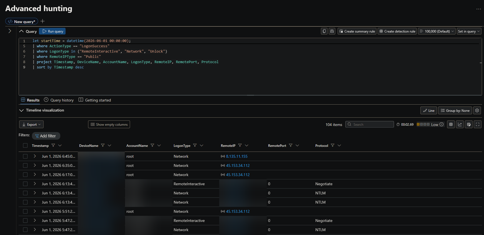
*Successful remote logons coming from the internet.*

**What came back:** 104 successful remote logons from public IPs, and they fell into two groups. On the Linux VMs, root was logging in over the network from outside IPs like 8.135.11.155 and 45.153.34.112. Those are the same IPs from the success-after-failures query, which backs up that the brute force actually landed. On the Windows VMs, it looked like regular users RDPing into their own lab machines. Each one showed a RemoteInteractive logon plus a couple of Network logons from the same IP at the same second, which is normal for RDP with Network Level Authentication.

### Use case 4: Lateral movement (AI-generated)

**What I did:** ran a query Claude came up with in the lab. It buckets successful `Network` and `RemoteInteractive` logons into 1 hour windows and counts how many different devices each account logged into. Anything hitting 5 or more devices in one hour gets flagged.

**Why I did it:** an attacker with one working set of credentials tends to hop from machine to machine fast. A normal user logs into their own computer and maybe a server or two.

**My note on it:** backup tools, patching tools, and vulnerability scanners log into lots of machines quickly all day, so in a real environment I'd allowlist known service accounts before trusting this. Also, this query doesn't use the `startTime` / `endTime` window like the others, so it runs against whatever time range is picked in the portal. Easy thing to miss when the AI writes it for you.

<details>
<summary><b>Query</b></summary>

```kql
DeviceLogonEvents
| where ActionType == "LogonSuccess"                  // only count footholds that worked
| where LogonType in ("Network", "RemoteInteractive")  // remote auth is the lateral signal
| where isnotempty(AccountName)
// 1 hour buckets so "many devices fast" stands out from slow daily activity
| summarize
    DistinctTargets = dcount(DeviceName),
    Targets         = make_set(DeviceName, 25),
    Logons          = count(),
    SourceIPs       = make_set(RemoteIP, 10)
    by AccountName, bin(TimeGenerated, 1h)
| where DistinctTargets >= 5                          // one account, 5+ machines in an hour
| sort by DistinctTargets desc
```
</details>

<!-- SCREENSHOT 19 (optional if empty): Lateral movement results showing DistinctTargets and Targets. Blur AccountName and device names. -->
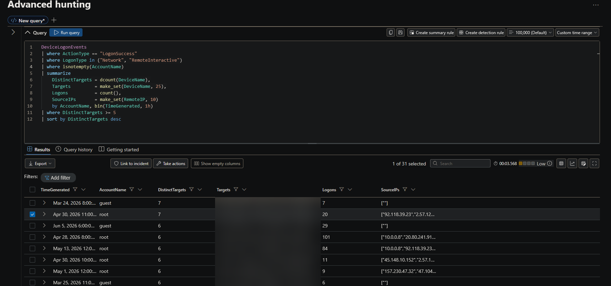
*Accounts logging into 5 or more devices within an hour.*

**What came back:** 31 results between March and June, and every one was for `root` or `guest`, with at most 7 devices in an hour. This one taught me more about the query than the environment. `root` and `guest` are local accounts that exist separately on every machine, so "root logged into 7 devices" is really 7 different root accounts that happen to share a name. The source IPs back that up. The root logons came from 10.0.0.8 (the scanner) and outside IPs like 92.118.39.23, which looks like the same internet brute forcing from earlier hitting several VMs. Nobody was hopping between machines with one account. To catch real lateral movement I'd group by `AccountDomain` and `AccountName` together, or by `AccountSid`, so each local account gets counted on its own. The guest logons also had no source IP at all.

---

## Part 6: DeviceProcessEvents Hunting

**What this table is:** every process that starts on the endpoints, with the full command line (`ProcessCommandLine`), where it ran from (`FolderPath`), and the parent process that launched it (`InitiatingProcessFileName`). The parent and child relationship is where a lot of the detection value is.

**How I approached it:** read the [DeviceProcessEvents table reference](https://learn.microsoft.com/en-us/defender-xdr/advanced-hunting-deviceprocessevents-table), then set the investigation window at the top.

```kql
let startTime = datetime(2026-06-02 00:00:00);
let endTime = datetime(2026-06-03 00:00:00);
```

| # | Use case | MITRE ATT&CK | NIST CSF 2.0 |
|---|---|---|---|
| 1 | Suspicious PowerShell command lines | [T1059.001](https://attack.mitre.org/techniques/T1059/001/) PowerShell, [T1027](https://attack.mitre.org/techniques/T1027/) Obfuscated Files or Information | DE.CM-09 |
| 2 | Office or browser apps spawning shells | [T1204.002](https://attack.mitre.org/techniques/T1204/002/) Malicious File, [T1566.001](https://attack.mitre.org/techniques/T1566/001/) Spearphishing Attachment | DE.CM-09 |
| 3 | Executables running from unusual folders | [T1204.002](https://attack.mitre.org/techniques/T1204/002/) Malicious File, [T1105](https://attack.mitre.org/techniques/T1105/) Ingress Tool Transfer | DE.CM-09 |
| 4 | Living off the land binaries (LOLBins) | [T1218](https://attack.mitre.org/techniques/T1218/) System Binary Proxy Execution, [T1105](https://attack.mitre.org/techniques/T1105/) Ingress Tool Transfer, [T1047](https://attack.mitre.org/techniques/T1047/) Windows Management Instrumentation | DE.CM-09 |

> DE.CM-09: computing hardware and software, runtime environments, and their data are monitored to find potentially adverse events.

### Use case 1: Suspicious PowerShell command lines

**What I did:** pulled every `powershell.exe` and `pwsh.exe` run where the command line had flags like `-enc`, `downloadstring`, `iex`, `-w hidden`, `frombase64string`, or `bypass`.

**Why I did it:** admins use PowerShell all day, so the flags in the command line are what give it away. Encoded commands hide what's actually running, and download strings pull code from the internet straight into memory.

**My note on it:** `bypass` is going to catch a lot of legit admin and management scripts since `-ExecutionPolicy Bypass` shows up everywhere. I'd expect most of the noise to come from that one.

<details>
<summary><b>Query</b></summary>

```kql
DeviceProcessEvents
| where TimeGenerated between (startTime .. endTime)
| where FileName =~ "powershell.exe" or FileName =~ "pwsh.exe"
| where ProcessCommandLine has_any (
    "-enc", "-encodedcommand", "-e ",
    "downloadstring", "downloadfile", "iex", "invoke-expression",
    "-windowstyle hidden", "-w hidden", "frombase64string", "bypass")
| project Timestamp, DeviceName, AccountName, FileName, InitiatingProcessFileName, ProcessCommandLine
| sort by Timestamp desc
```
</details>

<!-- SCREENSHOT 20: Suspicious PowerShell results with ProcessCommandLine visible. Blur DeviceName and AccountName. If empty, screenshot the empty result. -->
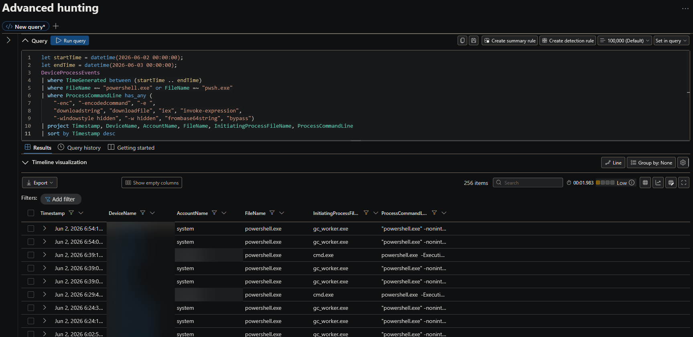
*PowerShell runs with encoded, hidden, or download-style flags.*

**What came back:** 256 results. Most of them were PowerShell running as SYSTEM with `-NonInteractive`, launched by `gc_worker.exe`. That looks like Azure's machine configuration agent (formerly Guest Configuration), which runs PowerShell on VMs to check their settings for Azure Policy. So it's Azure managing its own VMs, and it's the kind of noise this query needs an allowlist for before it's useful. The other rows in the top results were a regular user launching PowerShell from `cmd.exe` with an `-ExecutionPolicy` flag, which looks like someone running their own scripts in the lab. Nothing in the top results had encoded commands or download strings.

### Use case 2: Office or browser apps spawning shells

**What I did:** looked for Word, Excel, PowerPoint, Outlook, Chrome, Edge, or Firefox launching `cmd`, PowerShell, a script host (`wscript`, `cscript`), `mshta`, `rundll32`, or `regsvr32`.

**Why I did it:** Word has no reason to open a command prompt. That parent and child pair is what a malicious macro or a bad download looks like the moment it runs. An empty result here is a good result, and it's still worth showing since it proves the detection works.

<details>
<summary><b>Query</b></summary>

```kql
DeviceProcessEvents
| where TimeGenerated between (startTime .. endTime)
| where InitiatingProcessFileName in~ (
    "winword.exe", "excel.exe", "powerpnt.exe", "outlook.exe",
    "chrome.exe", "msedge.exe", "firefox.exe")
| where FileName in~ (
    "cmd.exe", "powershell.exe", "pwsh.exe", "wscript.exe",
    "cscript.exe", "mshta.exe", "rundll32.exe", "regsvr32.exe")
| project Timestamp, DeviceName, AccountName, InitiatingProcessFileName, FileName, ProcessCommandLine
| sort by Timestamp desc
```
</details>

<!-- SCREENSHOT 21 (optional): Office/browser spawning shell results, or the empty result. Blur DeviceName and AccountName. -->
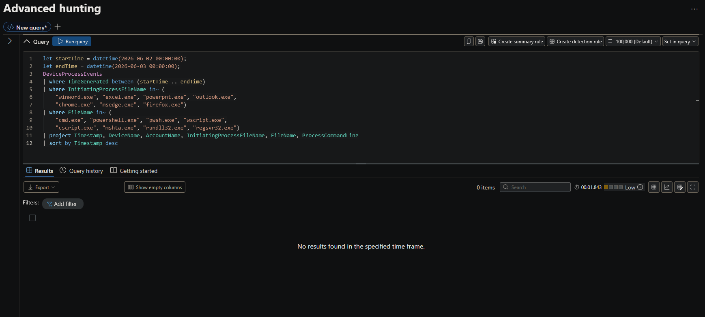
*Office apps or browsers launching a shell or script host.*

**What came back:** Nothing. Zero results for the same June 2 to June 3 window where the PowerShell query found 256 rows, so the process data was there. No Office app or browser launched a shell or script host on any lab machine that day. That's the result you want from this one, and it still proves the detection runs cleanly.

### Use case 3: Executables running from unusual folders

**What I did:** counted `.exe` processes running out of temp, AppData, Downloads, `Users\Public`, ProgramData, or `Windows\Temp`. Grouped by device, file name, and folder, with up to 10 example command lines for each.

**Why I did it:** real system programs live in System32 and Program Files. Malware usually gets dropped somewhere any user can write to, and these folders are the usual spots.

**My note on it:** OneDrive and Zoom both install per-user into AppData, along with a lot of updaters. This one needs an allowlist of known software before it's useful in a real environment.

<details>
<summary><b>Query</b></summary>

```kql
DeviceProcessEvents
| where TimeGenerated between (startTime .. endTime)
| where FolderPath has_any (
    @"\temp\", @"\appdata\", @"\downloads\",
    @"\users\public\", @"\programdata\", @"\windows\temp\")
| where FileName endswith ".exe"
| summarize Count = count(), Cmds = make_set(ProcessCommandLine, 10)
    by DeviceName, FileName, FolderPath
| sort by Count desc
```
</details>

<!-- SCREENSHOT 22: Unusual folder results showing FileName, FolderPath, Count. Blur DeviceName and any usernames inside FolderPath (C:\Users\<name>\...). -->
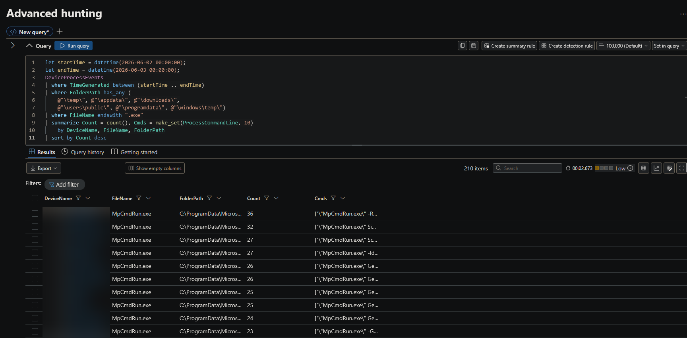
*Executables running out of user-writable folders.*

**What came back:** 210 results. Every one of the top results was `MpCmdRun.exe` running out of `C:\ProgramData\Microsoft\...`, 23 to 36 times per machine. That's Microsoft Defender's own command line tool, and Microsoft keeps the latest version in the `ProgramData\Microsoft\Windows Defender\Platform` folder, so the query flagged the antivirus itself. The command lines look like routine Defender tasks such as signature updates and scans. This is a good example of why this query needs an allowlist. I wouldn't allow MpCmdRun everywhere though, because it can also be abused to download files with `-DownloadFile`. I'd allow it from its normal path and still alert when that flag shows up.

### Use case 4: Living off the land binaries (LOLBins)

**What I did:** pulled every run of `certutil`, `bitsadmin`, `mshta`, `regsvr32`, `rundll32`, `wmic`, `msbuild`, and `installutil` with the command line and the parent process.

**Why I did it:** these come built into Windows and are signed by Microsoft. Attackers use them to download or run things so they don't have to bring their own tools, and a lot of security tools trust them by default.

**My note on it:** seeing `rundll32` is completely normal since Windows runs it constantly. The command line is what matters. `certutil` with `-urlcache` pulling a file from the internet is a red flag.

<details>
<summary><b>Query</b></summary>

```kql
DeviceProcessEvents
| where TimeGenerated between (startTime .. endTime)
| where FileName in~ (
    "certutil.exe", "bitsadmin.exe", "mshta.exe", "regsvr32.exe",
    "rundll32.exe", "wmic.exe", "msbuild.exe", "installutil.exe")
| project Timestamp, DeviceName, AccountName, FileName, ProcessCommandLine, InitiatingProcessFileName
| sort by Timestamp desc
```
</details>

<!-- SCREENSHOT 23: LOLBin results with ProcessCommandLine and InitiatingProcessFileName visible. Blur DeviceName and AccountName. -->
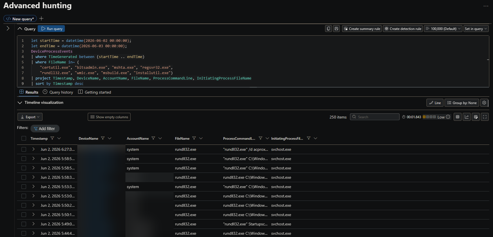
*Built-in Windows binaries attackers like to abuse.*

**What came back:** 250 results, and the top ones were all `rundll32.exe` launched by `svchost.exe`, running as SYSTEM or as the logged in user. The command lines point at DLLs under `C:\Windows\` with names like `acproxy` and `Startupscan`, which look like built-in Windows scheduled tasks for disk checks and startup app scanning. That's the normal rundll32 noise I expected from this query. Nothing in the top results looked like a LOLBin being abused, like rundll32 loading a DLL from a temp or user folder.

### What I made of DeviceProcessEvents

Every use case in this table gets its value from the command line or the parent process. PowerShell launched by Word with an encoded command is what turns everyday activity into an incident.

---

## Part 7: AI Testing

### What I did

For each table I exported 24 hours of logs as a CSV, gave it to Claude or ChatGPT, and asked:

> What kind of cybersecurity-related use cases can I derive from these logs?

Then I ran what it gave back in Advanced Hunting to see if it actually worked. The beaconing and data exfiltration queries in [Part 4](#part-4-nsg-flow-log-hunting-ntanetanalytics) and the lateral movement query in [Part 5](#part-5-devicelogonevents-hunting) were also AI-generated, and I ran those as part of this.

### Why I did it

I wanted to see if AI could speed up figuring out what a new table is good for, and how much I'd have to double check its work.

**What came back:** I ran the three AI-generated queries from the lab for beaconing, data exfiltration, and lateral movement. All three ran without errors, so the syntax was fine. The problems were in the logic, and I only caught them by reading the results. The beaconing query flagged one internal machine hitting a bunch of service ports on another every 4 hours, which looks like a scheduled scan more than C2. The lateral movement query grouped by account name only, so local accounts like root that exist on every machine looked like one account hopping between 7 devices. It also had no time filter of its own. The exfil query came back empty, and its 100 MB threshold would miss anyone sending smaller amounts over time. Every one of them needed tuning before I'd trust it.

### My take

AI is quick at listing what a table could detect, especially one I don't know well yet. It'll also use columns that don't exist, and the query looks just as confident either way. So I check every column against the schema, run it, and read the results before trusting it. I wouldn't put an AI-written query into a real SOC until I understood every line.

---

## Takeaways

- Picking the right table is a big part of the investigation. Figure out which plane the activity happened on first.
- An empty result usually means I'm wrong about the data. Run `distinct` before filtering.
- Thresholds in a detection are guesses until you've seen what normal looks like in that environment.
- The person doing the action is usually where the signal is. A VM delete only gets interesting once you look at who did it.
- On the endpoints, the parent process and command line matter more than the program name.
- A join links two things together without caring what order they happened in. If order matters, check the timestamps.
- AI helps with brainstorming detections. Column names still need to be checked against the schema every time.

## What I'd Do Different

- Take screenshots right when I run each query
- Write down the result count for every query as I go
- Tune at least one threshold and document the before and after

---

## Repo Layout

```
.
├── README.md
├── queries/
│   ├── 01-logging-layers.kql
│   ├── 02-kql-troubleshooting.kql
│   ├── 03-azureactivity.kql
│   ├── 04-ntanetanalytics.kql
│   ├── 05-devicelogonevents.kql
│   └── 06-deviceprocessevents.kql
├── ai-testing/
│   ├── PROMPTS.md
│   └── test-log.md
└── screenshots/
```

## References

- [Azure Monitor platform logs overview](https://learn.microsoft.com/en-us/azure/azure-monitor/essentials/platform-logs-overview) (Microsoft Learn)
- [AzureActivity table reference](https://learn.microsoft.com/en-us/azure/azure-monitor/reference/tables/azureactivity) (Microsoft Learn)
- [NTANetAnalytics table reference](https://learn.microsoft.com/en-us/azure/azure-monitor/reference/tables/ntanetanalytics) (Microsoft Learn)
- [DeviceLogonEvents table reference](https://learn.microsoft.com/en-us/azure/azure-monitor/reference/tables/devicelogonevents) (Microsoft Learn)
- [DeviceProcessEvents table in advanced hunting](https://learn.microsoft.com/en-us/defender-xdr/advanced-hunting-deviceprocessevents-table) (Microsoft Learn)
- [Traffic analytics schema and data aggregation](https://learn.microsoft.com/en-us/azure/network-watcher/traffic-analytics-schema) (Microsoft Learn)
- [Virtual Machines: Create Or Update](https://learn.microsoft.com/en-us/rest/api/compute/virtual-machines/create-or-update) (Azure REST API reference)
- [MITRE ATT&CK Enterprise Matrix](https://attack.mitre.org/)
- [NIST Cybersecurity Framework 2.0](https://nvlpubs.nist.gov/nistpubs/CSWP/NIST.CSWP.29.pdf)
